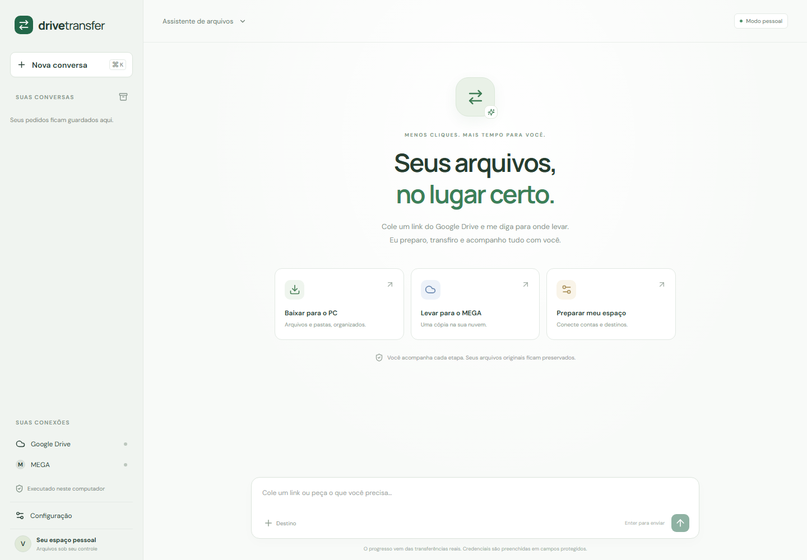
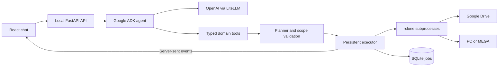

# Drive Transfer Agent

**I turned file transfers into a conversation.**

A local assistant that copies Google Drive files and folders to your PC or MEGA. Choose what to copy, review the destination, check available space, and track the work through chat.

Built with **Google ADK · OpenAI · FastAPI · React · rclone**.

[Watch the 45-second demo](docs/linkedin-demo/drive-transfer-agent-linkedin.mp4) · [How it works](#how-it-works) · [Quick start](#quick-start) · [Architecture](#architecture)



> **Demo:** the [English promotional video](docs/linkedin-demo/drive-transfer-agent-linkedin.mp4) uses fictional data, simulated responses and accelerated progress. Its recording layer translates the interface into English; the application's default interface and agent instructions are in Portuguese. The demo is not evidence of a real cloud transfer.

## Why I built it

Moving a few selected folders between services can involve a lot of repetitive work: finding the right sources, choosing exact destination paths, checking space, copying, and verifying the result.

I built Drive Transfer Agent to bring that workflow into a conversation while keeping execution in a dedicated, persistent file-transfer engine. The model interprets the request and calls typed tools. The backend validates the scope and rclone performs the file operations.

## How it works

1. **Describe the task.** Paste a Google Drive link and specify the folders and destination.
2. **Resolve the selection.** The agent discovers source IDs and selects exact names or numbered ranges, including folder `0`.
3. **Prepare the copy.** A persistent plan records the selected sources, destination paths and options. You can request a size and space check before copying.
4. **Review when requested.** Ask the agent to wait for your approval; the executor enforces that requirement. A direct copy request can proceed without an extra approval turn.
5. **Follow the job.** Transfer status, progress, verification and reports remain available through the conversation.

For example, in the application's default language:

```text
Use este link do Drive: <folder link>.
Selecione somente as pastas 0 a 2 e prepare a cópia para /Demo no MEGA.
Mostre os caminhos e aguarde minha aprovação antes de copiar.
```

Selected folders go directly to `/Demo/<folder name>`; the parent folder is not added as another layer. A later request can reuse the conversation's destination.

## What it can do

| Capability | Behavior |
| --- | --- |
| Drive → PC or MEGA | Copy individual files or selected folders without deleting the source |
| Source discovery | Browse children, search names, resolve IDs, select exact names or numbered ranges |
| Persistent planning | Keep the selection, destination and intent associated with a conversation |
| Preflight checks | Inspect file counts, sizes, destination capacity and temporary staging needs |
| Transfer queue | Prepare up to 100 items; rename, reorder, remove and undo queue changes |
| Progress and reports | Follow copy, verification, bounded repair, cancellation and final status |
| Conversation history | Archive, restore or delete conversations with deletion confirmation |
| Protected setup | Configure Google OAuth, MEGA and the model through dedicated setup fields |
| Google document exports | Export supported Docs, Sheets and Slides as DOCX, XLSX and PPTX |

The agent has **27 domain tools** for these operations. See the [tool catalog and planning examples](docs/ferramentas-e-planejamento.md) (Portuguese).

**Verification scope matters:** MEGA verification compares file sizes. Matching sizes do **not** prove byte-for-byte equality. The application reports the verification coverage instead of treating all checks as equivalent.

## Architecture



The model receives tool results and operational context; it has no arbitrary shell tool. The executor validates the selected sources and saved plan, enforces requested approval, serializes long-running work, and records job state independently of the model session.

Job creation is idempotent. After an application restart, unfinished jobs are marked interrupted; retrying creates a new operation. A chat session is not a checkpoint for an in-flight rclone process.

## Quick start

**Requirements:** Python 3.12+, [uv](https://docs.astral.sh/uv/), Node.js 22+ and npm. This is a source installation, not a standalone desktop executable.

```bash
git clone https://github.com/caleo-hub/drive-transfer-agent.git
cd drive-transfer-agent
uv sync --locked
cd web
npm ci
npm run build
cd ..
uv run drive-transfer-agent --no-browser
```

Open **http://127.0.0.1:8765**.

On Windows, after installing the requirements, you can instead run `instalar.ps1` once and use `iniciar.bat` to launch the application. Development began on Ubuntu; Windows uses its own local paths and processes. The application runs on the computer where it is launched.

### Connect your services

Use the **Configuração** setup panel:

1. **Aplicativo:** install rclone using the managed installer, which verifies its SHA-256 checksum.
2. **OpenAI:** enter your API key in the protected field.
3. **Google Drive:** configure your OAuth client and authorize Drive access.
4. **MEGA:** connect the account if you want cloud destinations.
5. **Destinos / Preferências:** register a destination and choose defaults.

Model API usage and cloud-provider quotas depend on your accounts. Setup cards work before the model is configured.

### Google OAuth setup

Create a Google Cloud project, enable the **Google Drive API**, configure the consent screen, and create an OAuth client for a **desktop application**. While the OAuth app is in testing, add the authorized account as a test user.

Enter `GOOGLE_CLIENT_ID` and, when provided by Google, `GOOGLE_CLIENT_SECRET` in the protected Google Drive setup fields or environment. For web clients, authorize exactly:

```text
http://127.0.0.1:8765/api/setup/oauth/callback
```

The flow uses PKCE and the `drive.readonly` scope. Authorization happens on Google's sign-in page. Testing-mode tokens may expire; reconnect through the setup panel when needed.

### Configuration

See [.env.example](.env.example). Protected setup fields are available for credentials; environment values take precedence.

| Variable | Purpose |
| --- | --- |
| `AGENT_MODEL` | OpenAI model via LiteLLM; default `openai/gpt-5.4-mini` |
| `OPENAI_API_KEY` | Optional environment alternative to the protected model setup field |
| `GOOGLE_CLIENT_ID`, `GOOGLE_CLIENT_SECRET` | Your provisioned Google OAuth client |
| `DTA_PORT` | Local port; default `8765` |
| `DTA_DATA_DIR` | Private application data directory; defaults to the OS application-data location |
| `RCLONE_BIN` | Explicit rclone executable; takes precedence over managed installation and PATH |
| `DTA_MASTER_KEY` | Explicit vault-key alternative for environments without a system keyring |

Operational data is stored in `jobs.sqlite3`, ADK sessions in `sessions.sqlite3`, and encrypted credentials in `secrets.enc`.

## Privacy and execution boundaries

- The API listens on loopback and is designed for one user on one computer.
- Credentials are encrypted with Fernet; the vault key is kept in the system keyring, including Windows Credential Manager.
- Headless environments without a keyring must explicitly provide `DTA_MASTER_KEY` through a secret manager. There is no plaintext-key fallback.
- Credentials entered in protected setup fields are kept out of model messages and tool arguments. **Chat text, file names, paths and summarized tool results may be sent to OpenAI** as part of the agent context.
- rclone receives private backend configuration through its process environment and uses in-memory configuration. The global rclone configuration is not copied.
- Domain tools do not expose destructive sync, source deletion, arbitrary shell commands or permission changes.

Read [security and privacy](docs/security.md) for details (Portuguese). Do not commit your application data directory, databases, logs or credentials.

## Current limits

- **One long-running operation per executor.** Closing the browser tab does not stop the job; stopping the application interrupts it.
- **No guaranteed partial-file resume.** A retry is a new operation and uses the files already present.
- **Existing destination files can be overwritten if different.** Extra destination files and original source files are preserved.
- **MEGA verification is size-based.** MEGA logins and quotas can also require user intervention. Separate subprocesses are used per stage; accounts requiring a fresh 2FA code at every login may need reauthorization between stages.
- **Individual files may need local staging space.** The preflight accounts for this.
- **Unknown sizes are reported.** An entirely empty visible source is flagged for attention rather than silently replicated.
- **Drive shortcuts need the original link.** Unsupported Google document types receive an explicit error.
- **Search has bounds:** recursive discovery is limited in depth, pages and results, and reports truncation.
- Scheduling, transcription, destructive synchronization, multiple users and additional cloud providers are outside this version's scope.

## Development and validation

For frontend hot reload, run `npm run dev` in `web/` while the backend is running. Vite proxies `/api` to the local backend.

```bash
# Backend
uv run pytest -q
uv run ruff check .

# Frontend (from web/)
npm test
npm run format:check
npm run build
npx playwright install chromium
npm run test:e2e
```

Local integration tests exercise rclone against temporary directories without cloud accounts. CI runs the backend tests and frontend build on Ubuntu and Windows, with browser tests on Ubuntu. The Python package can be built with `uv build` after building the frontend.

Mocked model tests and local file tests do not validate Google OAuth, MEGA login, provider quotas or real cloud transfers. The [validation record](docs/validation.md) and [manual acceptance checklist](docs/acceptance.md) distinguish these checks.

## Demo and documentation

- [English demo video — 45 seconds](docs/linkedin-demo/drive-transfer-agent-linkedin.mp4)
- [Demo cover](docs/linkedin-demo/capa.png) and [LinkedIn post](docs/linkedin-demo/postagem.md)
- [Recording source and reproduction instructions](docs/linkedin-demo/README.md)
- [Final video validation](docs/linkedin-demo/validation/REVIEW.md)
- [Original interface demo](docs/demo.mp4) — preserved, with simulated data
- [Architecture](docs/architecture.md), [tool catalog](docs/ferramentas-e-planejamento.md), [security](docs/security.md) and [acceptance checklist](docs/acceptance.md) — detailed documentation in Portuguese

## License

[MIT](LICENSE).
