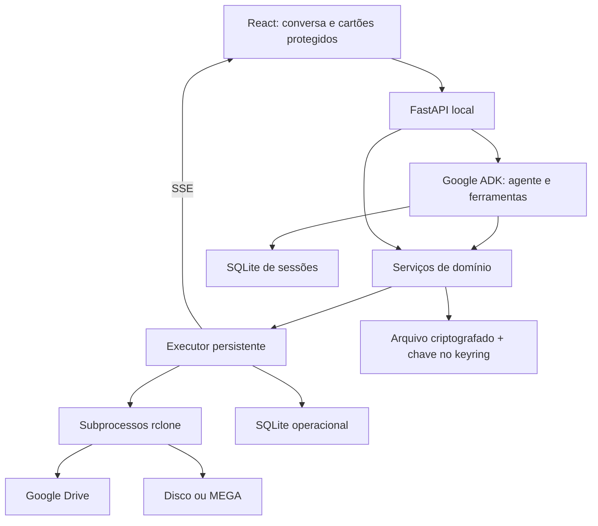

# Arquitetura e decisões

O novo backend não depende do programa legado. O inventário orientou invariantes como uma operação ativa, auditoria após cópia, reparo apenas de diferenças e cancelamento de subprocessos silenciosos.

## Trabalho longo

Criação é transacional e tem chave de idempotência. O banco possui índice que impede duas tarefas ativas, inclusive entre chamadas simultâneas. Um worker assíncrono controla subprocessos. Progresso vem do JSON do rclone; a etapa é independente do percentual da cópia.

Após reinício, jobs pendentes/em execução viram interrompidos. Sessão ADK não é um checkpoint do subprocesso. O SSE entrega snapshot atual e revisão, não replay integral. O histórico operacional não depende da sessão do modelo.

Um bloqueio de instância é adquirido antes de abrir o banco: abrir o programa duas vezes não reconcilia nem interrompe o executor que já está ativo. Eventos persistidos têm resumos compactos e retenção limitada por tarefa; snapshots atuais preservam o resultado completo.

## Arquivos e pastas

Metadados de um link são resolvidos pela API Drive usando o token OAuth da instalação. Pastas usam listagem recursiva, copy e check. Arquivos individuais são obtidos por ID em staging local e então copiados ao destino; isso evita depender de listagem da pasta pai.

O relatório combinado do check distingue `+` (ausente no destino), `*` (diferente) e `!` (erro de leitura). Apenas `+` e `*` podem gerar reparo. Cada rodada é seguida de nova auditoria, inclusive a última.

O modelo vê referências opacas às fontes. Chaves de recurso permanecem disponíveis ao executor e são removidas dos dados públicos. Filas têm IDs estáveis e persistência própria.

## Primeiro uso

Os cartões funcionam sem modelo. Instalação, OAuth e campos protegidos são executados por rotas de domínio. O agente pode solicitar um cartão, mas não receber sua senha. Configuração e transferências compartilham exclusão de execução para não trocar uma conta em uso.

## Compatibilidade

Desenvolvimento Linux usa caminhos POSIX locais. Windows usa caminhos absolutos/UNC, rejeita nomes reservados e executa subprocessos sem janela. A aplicação é monousuário e escuta somente no loopback. Um único worker Uvicorn é obrigatório; não publicar esta API diretamente na rede.
